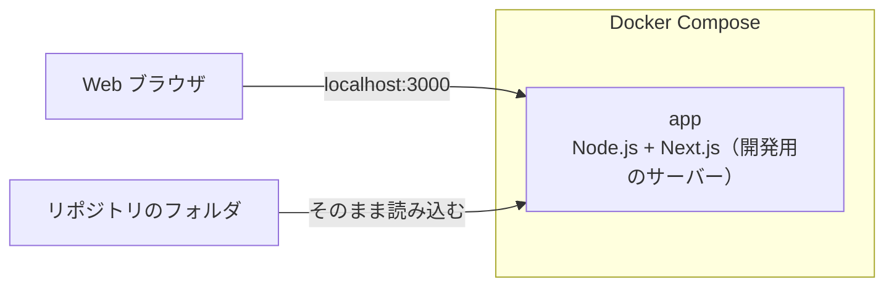

# Architecture（構成）

このリポジトリが、どういう部品でできていて、どこに何を書くのかの説明です。

- [1. ブランチの考え方](#1-ブランチの考え方)
- [2. 実行環境](#2-実行環境)
- [3. ページと API の置き方](#3-ページと-api-の置き方)
- [4. ディレクトリ構成](#4-ディレクトリ構成)
- [5. 確認の仕組み](#5-確認の仕組み)
- [6. 注意点](#6-注意点)

---

## 1. ブランチの考え方

Next.js のプロジェクトでは、同じ役割の道具に、いくつかの選択肢があります。このリポジトリでは、次の4つを「軸」として、選択肢ごとの組み方をブランチで残しています。

| 軸 | 選択肢の例 |
| --- | --- |
| ルーター | App Router、Pages Router |
| スタイル | CSS Modules、styled-components、Tailwind CSS |
| 検査と整形 | ESLint + Prettier、Biome |
| 単体テスト | Vitest、Jest |

`main` ブランチには、どの選択でも変わらない、共通の部分だけを入れています。

| `main` に入っているもの | `main` に入っていないもの |
| --- | --- |
| Next.js、React、TypeScript | スタイルの道具 |
| App Router の、最小のページと API | コードの検査と整形の道具 |
| Docker、Makefile | 単体テストの道具 |
| 自動テスト（型の検査、ビルド、起動の確認） | UI の部品、Storybook |

ルーターだけは、`main` に App Router を入れています。Next.js は、ルーターがないと起動できないためです。Pages Router を使うブランチでは、`src/app/` を `src/pages/` に置き換えています。

4つの軸をすべて選んだ、そのまま使える形は、`example/` で始まるブランチにあります。一覧は、[README](../README.md) の「Branch」を参照してください。

軸ごとのブランチ（「テストだけを足したブランチ」など）は、作っていません。軸同士が関係し合っていて（テストの書き方は、スタイルで変わります）、あとから組み合わせることもできないためです（どのブランチも、`package.json` を書き換えるので、合わせると衝突します）。

---

## 2. 実行環境

Docker Compose で、Node.js のコンテナを1つ動かします。定義は、[docker-compose.yml](../docker-compose.yml) にあります。



知っておくとよい点は、次の5つです。

- **ファイルを保存すると、開いているページに、すぐ反映されます。** コンテナは、リポジトリのフォルダをそのまま読み込んでいます。
- **パッケージは、Docker のボリュームに入ります。** 手元のフォルダの `node_modules` には、中身が入りません。そのため、手元のエディタは、パッケージの型を見つけられないことがあります（「6. 注意点」を参照）。
- **コンテナの中のプログラムは、手元のパソコンと同じユーザーで動きます。** Next.js が作るファイル（`.next` フォルダ）が、手元で消せないファイルにならないようにするためです。ユーザーの番号は、`Makefile` が調べて、コンテナに渡しています。そのため、コマンドは、`docker compose` を直接使わずに、`make` から実行してください。
- **サーバーには、手元のパソコンからしかつなげません。** `docker-compose.yml` の `ports` に、`127.0.0.1` を付けているためです。
- **Next.js は、利用状況を送信しません。** `Dockerfile` で、送信を止める設定（`NEXT_TELEMETRY_DISABLED`）をしています。

---

## 3. ページと API の置き方

`main` ブランチは、App Router を使っています。App Router では、`src/app/` の中のフォルダの構成が、そのまま URL になります。

| ファイル | 役割 | URL |
| --- | --- | --- |
| `src/app/layout.tsx` | すべてのページに共通の枠組み（`<html>` と `<body>`）。ページの題名も、ここで決めます | |
| `src/app/page.tsx` | トップページ | `/` |
| `src/app/api/hello/route.ts` | API の見本 | `/api/hello` |

ページや API を足すときは、フォルダを作って、決まった名前のファイルを置きます。

| 足すもの | 置くファイル | URL |
| --- | --- | --- |
| ページ | `src/app/about/page.tsx` | `/about` |
| 番号などで変わるページ | `src/app/posts/[id]/page.tsx` | `/posts/1`、`/posts/2` など |
| API | `src/app/api/tasks/route.ts` | `/api/tasks` |

`page.tsx` は、何もしなければ、サーバーの側で動く部品（Server Component）になります。クリックなどの操作に反応させたい部品は、ファイルの先頭に `'use client'` と書いて、ブラウザの側で動く部品（Client Component）にします。

`src/` の中のファイルは、`~/` で始まる書き方で読み込めます（[tsconfig.json](../tsconfig.json) の `paths` で決めています）。

```ts
import { something } from '~/shared/something';
```

---

## 4. ディレクトリ構成

| ディレクトリ・ファイル | 内容 |
| --- | --- |
| `src/app/` | ページと API |
| `next.config.ts` | Next.js の設定 |
| `tsconfig.json` | TypeScript の設定 |
| `package.json` | パッケージと、実行するコマンド（`scripts`）の定義 |
| `pnpm-lock.yaml` | 実際にインストールされるパッケージの、正確なバージョンの記録 |
| `.node-version` | Node.js のバージョン。コンテナを使わずに、手元の Node.js で動かすときに参照されます |
| `Dockerfile`、`docker-compose.yml` | コンテナの定義 |
| `Makefile` | よく使うコマンドをまとめたもの |
| `scripts/smoke.sh` | 起動したサーバーを、実際に呼んで確かめるスクリプト。自動テストから実行されます |
| `.github/workflows/test.yml` | 自動テストの設定 |
| `.github/dependabot.yml` | Dependabot（依存の更新の通知）の設定 |
| `readme/` | このリポジトリの文書 |

次のものは、自動で作られます。Git の管理の対象から外しています。

| ディレクトリ・ファイル | 内容 |
| --- | --- |
| `.next/` | Next.js が、開発用のサーバーとビルドで使う作業用のフォルダ |
| `next-env.d.ts` | Next.js が作る、型の定義のファイル |
| `node_modules/` | パッケージ |

---

## 5. 確認の仕組み

`main` ブランチには、単体テストは入っていません。次の3つで、動く状態であることを確かめています。

| 確認 | コマンド | 確かめていること |
| --- | --- | --- |
| 型の検査 | `make js/typecheck` | TypeScript の型に、誤りがないこと |
| 本番用のビルド | `make js/build` | 公開用の形に、ビルドできること |
| 起動の確認 | `bash scripts/smoke.sh` | 起動したサーバーが、ページと API に応答すること |

3つとも、自動テスト（GitHub Actions）から実行されます。ページや API を足したら、[scripts/smoke.sh](../scripts/smoke.sh) に、それを呼ぶ行を足してください。

単体テストと、コードの検査は、組み合わせのブランチで足しています。

---

## 6. 注意点

- **公開の設定は、入れていません。** 公開先（Vercel、自前のサーバー、静的なファイルへの書き出し）によって、設定が変わるためです。自動テストでは、本番用のビルドが通ることだけを確かめています。
- **手元のエディタで、パッケージの型が見つからないことがあります。** パッケージが、コンテナの側にしかないためです。エディタの補完や、型のエラーの表示を使いたい場合は、次のどちらかにしてください。
  - VS Code の「Dev Containers」の機能で、コンテナの中のフォルダを開く。
  - 手元にも Node.js と pnpm を入れて、`pnpm install` を実行する（バージョンは、`.node-version` と、`package.json` の `packageManager` に合わせます）。
- **TypeScript は、最新の 7 ではなく、6 を使っています。** コードの検査の道具（typescript-eslint）が、まだ 7 に対応していないためです。組み合わせのブランチとそろえるために、`main` でも 6 にしています。
